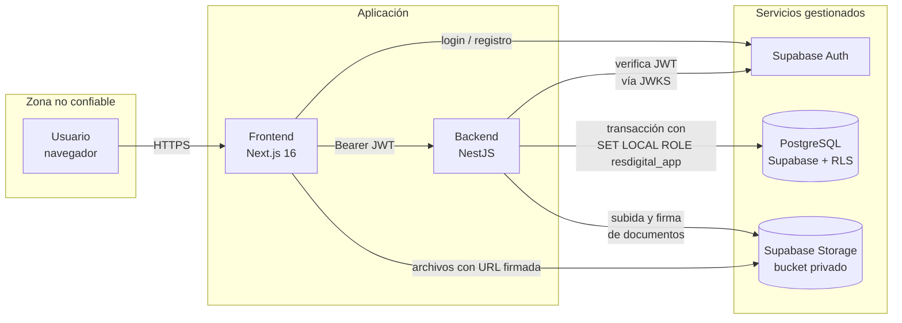

# Arquitectura y acceso (ítem 1.2)

Estado de este documento: `observado` (derivado del código). Ariana debe aprobarlo.

## Componentes y límites de confianza

**Límites de confianza**

1. **Navegador → Frontend/API:** todo lo que llega es no confiable; se valida con `class-validator` (`whitelist` y `forbidNonWhitelisted`), `zod` y `helmet`.
2. **API → Supabase Auth:** el JWT solo se acepta si la firma verifica contra el JWKS.
3. **API → PostgreSQL:** la app se conecta con el rol `resdigital_app`, sin `BYPASSRLS`; el aislamiento por finca lo aplica la base, no solo el código.
4. **Frontend → Storage:** el bucket de documentos es privado; no hay políticas públicas (migración `RevokeAnimalDocsPublicStoragePolicies`).

## Servicios externos

Supabase (Auth, PostgreSQL, Storage), GitHub (código y CI), Docker Hub (imágenes) y el proveedor de IA. Detalle en [terceros-y-secretos.md](terceros-y-secretos.md).

## Datos protegidos

| Dato | Por qué es sensible | Si se expone | Si se modifica | Si se pierde |
|---|---|---|---|---|
| Identidad y rol (`usuario`, JWT) | Define quién entra y con qué privilegios | Suplantación | Escalada de privilegios | Nadie puede entrar |
| `tenant_id` | Separa fincas | Acceso cruzado | Mezcla de datos | — |
| Animales, pesajes, producción | Información productiva y comercial de la finca | Daño comercial | Decisiones erróneas | Pérdida de trazabilidad |
| Tratamientos y retiros | Impacto sanitario y comercial | Menor | **Alto:** leche o carne con retiro sale al mercado | Pérdida de evidencia |
| Documentos de animales (Storage) | Pueden contener datos de terceros | Fuga | Documento falso | Pérdida |
| Invitaciones | Dan acceso a la finca | Alta no autorizada | Rol indebido | — |
| `service_role`, `DATABASE_URL`, secreto JWT | Acceso total a la base | **Crítico:** salta RLS | Crítico | Interrupción |

## Tabla de acceso: actor/rol → recurso → acción → condición

`P` = propietario, `A` = administrador, `V` = veterinario, `E` = peón. **Condición base de todas las filas:** sesión válida y datos de la propia finca (RLS). Sin sesión: 401 en todas las rutas salvo `GET /`.

| Recurso | Acción | P | A | V | E | Notas |
|---|---|:-:|:-:|:-:|:-:|---|
| Raíz `GET /` | Leer | sí | sí | sí | sí | Pública también sin sesión (`@Public`) |
| Perfil `GET /auth/perfil` | Leer | sí | sí | sí | sí | Solo el propio |
| Invitaciones | Crear y listar | sí | no | no | no | Solo propietario |
| Confirmar invitación | Confirmar | sí | sí | sí | sí | Sin `@Roles`; depende de las claims y la invitación (ver D-03) |
| Animales | Listar y ver | sí | sí | sí | sí | Sin `@Roles` (ver D-01) |
| Animales | Crear y editar | sí | sí | no | no | |
| Animales | Dar de baja y reactivar | sí | sí | no | no | |
| Animales | Ver baja, composición genética, crías | sí | sí | sí | sí | `@Roles` con los cuatro |
| Documentos del animal | Listar | sí | sí | sí | sí | Sin `@Roles` (ver D-01) |
| Documentos del animal | Subir | sí | sí | no | no | |
| Pesajes | Crear | sí | sí | no | sí | |
| Pesajes | Consultar por animal | sí | sí | sí | sí | Sin `@Roles` |
| Potreros | Crear, editar, borrar | sí | sí | no | no | |
| Potreros | Asignar animales | sí | sí | no | sí | |
| Potreros | Listar y ver movimientos | sí | sí | sí | sí | Sin `@Roles` |
| Producción de leche | Registrar y editar | sí | sí | no | sí | Editar permitido al peón (ver D-04) |
| Producción de leche | Anular | sí | sí | no | no | |
| Producción de leche | Consultar | sí | sí | sí | sí | |
| Lactancia | Iniciar y finalizar | sí | sí | no | no | |
| Lactancia | Consultar | sí | sí | sí | sí | |
| Eventos reproductivos | Servicio, parto, secado | sí | sí | sí | sí | |
| Eventos reproductivos | Diagnóstico | sí | sí | sí | no | |
| Eventos reproductivos | Consultar estado y próximos eventos | sí | sí | sí | sí | |
| Tratamientos | Crear | sí | sí | sí | sí | |
| Tratamientos | Corregir y anular | sí | sí | sí | no | |
| Tratamientos | Consultar retiros y estado | sí | sí | sí | sí | |
| Catálogos (razas, medicamentos, padecimientos) | Leer | sí | sí | sí | sí | |

**Propiedad del recurso:** en cualquier fila, un usuario de otra finca no accede (F-03). No hay roles por propiedad individual; el único límite de propiedad es la finca.

> Esta tabla se deriva de los decoradores `@Roles` y de `role-matrix.spec.ts`. Si el código cambia, se actualiza aquí en el mismo PR y se ajustan las pruebas de `test/authz/` (ítem 4.5).
