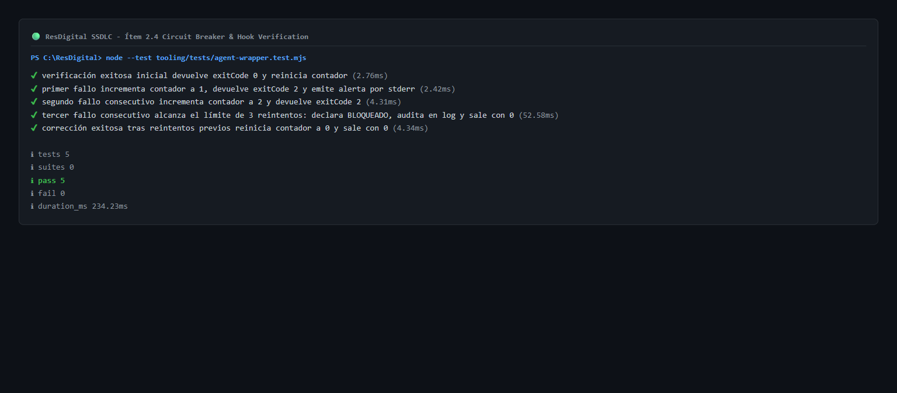
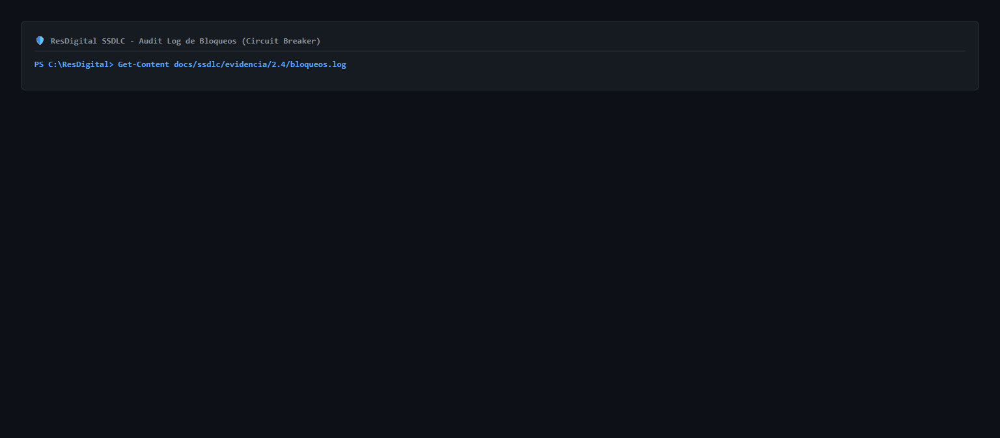

# Evidencia ítem 2.4 (Cristhian)

Conexión del agente con las comprobaciones locales mediante hook y wrapper automatizado con límite de 3 reintentos.

## 1. Arquitectura del Mecanismo

```
  ┌─────────────────────────────────────────────────────────────┐
  │                 Agente (Claude Code CLI)                   │
  └──────────────────────────────┬──────────────────────────────┘
                                 │ Evento: Stop (Fin de turno)
                                 ▼
  ┌─────────────────────────────────────────────────────────────┐
  │           .claude/hooks/stop-verify.sh (Hook Adaptador)     │
  └──────────────────────────────┬──────────────────────────────┘
                                 │ Envía stdin (JSON)
                                 ▼
  ┌─────────────────────────────────────────────────────────────┐
  │           tooling/agent-wrapper.mjs (Motor Node.js)         │
  └───────┬──────────────────────┬──────────────────────┬───────┘
          │                      │                      │
   1. Lee estado         2. Ejecuta             3. Evalúa resultado
   .claude/.verify-retries  scripts/verify.sh       y reintentos
          │                      │                      │
          │                      │                      ├── APROBADO: Resetea retries a 0 -> exit 0
          │                      │                      ├── FALLÓ (< 3 intentos): retries++ -> exit 2 (reabre turno)
          │                      │                      └── FALLÓ (>= 3 intentos):
          │                      │                           ├── Escribe docs/ssdlc/evidencia/2.4/bloqueos.log
          │                      │                           ├── Emite "BLOQUEADO: requiere intervención humana"
          │                      │                           └── exit 0 (detiene bucle del agente)
```

## 2. Componentes Implementados

| Componente | Archivo | Responsabilidad |
|---|---|---|
| **Harness del Agente** | `.claude/settings.json` | Registra el hook de evento `Stop` y define la política restrictiva de `permissions.deny` (Ítem 2.5). |
| **Referencia de Reglas** | `CLAUDE.md` | Importa `@AGENTS.md` para unificar el contexto normativo de gobernanza del agente. |
| **Hook de Parada** | `.claude/hooks/stop-verify.sh` | Adaptador Shell POSIX que intercepta la finalización de turno y delega en el wrapper de Node. |
| **Motor Multiplataforma** | `tooling/agent-wrapper.mjs` | Control de lectura de stdin, ejecución de `verify.sh`, conteo de reintentos y auditoría de bloqueos. |
| **Pruebas Unitarias** | `tooling/tests/agent-wrapper.test.mjs` | Suite automatizada de 5 pruebas con `node:test` verificando cada rama de ejecución y límites. |
| **Script de Automatización** | `package.json` (`agent:verify`) | Permite ejecutar el wrapper directamente vía CLI (`pnpm agent:verify`). |
| **Registro de Auditoría** | `docs/ssdlc/evidencia/2.4/bloqueos.log` | Registro inmutable de eventos de bloqueo cuando un agente agota sus 3 reintentos permitidos. |

## 3. Pruebas Automatizadas del Wrapper

Archivos de volcado y simulación disponibles:
- [agent-wrapper-tests-salida.txt](./agent-wrapper-tests-salida.txt)
- [circuit-breaker-simulacion.txt](./circuit-breaker-simulacion.txt)
- [bloqueos.log](./bloqueos.log)

Comando ejecutado: `node --test tooling/tests/agent-wrapper.test.mjs`

```
✔ verificación exitosa inicial devuelve exitCode 0 y reinicia contador (2.7646ms)
✔ primer fallo incrementa contador a 1, devuelve exitCode 2 y emite alerta por stderr (2.4293ms)
✔ segundo fallo consecutivo incrementa contador a 2 y devuelve exitCode 2 (4.3151ms)
✔ tercer fallo consecutivo alcanza el límite de 3 reintentos: declara BLOQUEADO, audita en log y sale con 0 (52.589ms)
✔ corrección exitosa tras reintentos previos reinicia contador a 0 y sale con 0 (4.3427ms)
ℹ tests 5
ℹ suites 0
ℹ pass 5
ℹ fail 0
```

### Captura de Pruebas Unitarias (5/5 PASS)


## 4. Evidencia de Ejecución en Vivo

1. **Ejecución limpia (Aprobada):**
   - Comando: `node tooling/agent-wrapper.mjs`
   - Código de salida: `0`
   - Salida:
     ```
     ===== Resumen =====
     OK          lint
     OK          typecheck
     OK          pruebas
     OK          build
     OK          gitleaks
     RESULTADO: APROBADO
     RESULTADO: APROBADO (todas las verificaciones del agente pasaron exitosamente)
     ```
   - Contador `.claude/.verify-retries`: `0`.

2. **Simulación de Falla y Reintento (Rechazo código 2):**
   - Cuando una prueba o verificación de lint/gitleaks falla:
     - El wrapper incrementa `.claude/.verify-retries` a `1`.
     - Sale con código `2`.
     - Claude Code intercepta el código `2` y reinyecta la salida de error en el contexto del modelo obligándolo a autocorregirse.

3. **Simulación de Bloqueo tras 3 reintentos (Demo D3):**
   - Si tras 3 intentos consecutivos el fallo persiste:
     - El wrapper emite:
       ```
       BLOQUEADO: requiere intervención humana (límite de 3 reintentos superado).
       Se ha registrado el incidente en: docs/ssdlc/evidencia/2.4/bloqueos.log
       ```
     - Sale con código `0` para que el agente se detenga e informe al desarrollador, previniendo bucles infinitos.
     - Añade la entrada correspondiente a `bloqueos.log`.

### Captura de Auditoría de Bloqueo (Circuit Breaker)


## 5. Qué comprueba y qué NO comprueba

- **Qué comprueba:**
  - Que el agente no pueda concluir una tarea si el código rompe compilación, linting, pruebas unitarias o introduce secretos detectados por Gitleaks.
  - Que el agente reciba retroalimentación autónoma de los errores cometidos para corregirlos sin intervención humana inmediata.
  - Que ante fallos repetitivos y complejos (>= 3 intentos), el flujo se corte obligando a la intervención humana.
- **Qué NO comprueba:**
  - Pruebas de integración con base de datos real (RLS) o e2e (requieren entorno PostgreSQL/Supabase en ejecución).
  - No valida la corrección conceptual de reglas de negocio que carezcan de pruebas unitarias.
