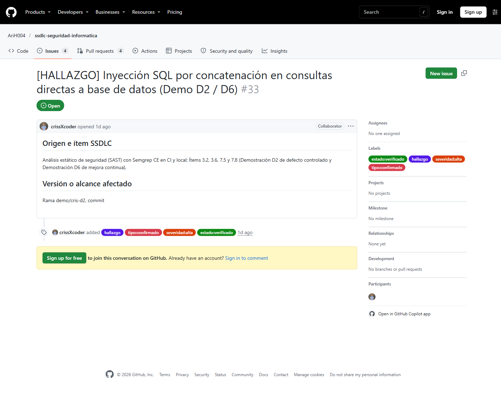

# Evidencia: Aprendizaje al Siguiente Ciclo de Desarrollo (Ítem 7.8 — Demo D6)

**Responsable:** Cristhian (`crissXcoder`)  
**Fecha:** 2026-11-12  
**Marco de referencia:** OWASP SAMM v2 (Defect Management — Feedback Loop) / NIST SSDF RV.3.2  
**Registro de Hallazgo:** [Issue #33 en GitHub](https://github.com/AriH004/ssdlc-seguridad-informatica/issues/33)  
**Pull Request de Demostración:** [PR #32: [DEMO D2] Bloqueo de integracion por inyeccion SQL (Semgrep CE)](https://github.com/AriH004/ssdlc-seguridad-informatica/pull/32)  
**Documento formal:** [`docs/ssdlc/aprendizaje-siguiente-ciclo.md`](../aprendizaje-siguiente-ciclo.md)

---

## 1. Evidencia de la Demostración D6 (Mejora Continua)

La Demostración D6 une los ítems 7.5 (Registro único de hallazgos) y 7.8 (Aprendizaje al siguiente ciclo) cerrando el ciclo completo de vida del defecto:

```
[1. Detección]             [2. Registro]              [3. Remediación & CI]        [4. Aprendizaje 7.8]
Vulnerabilidad SQLi   ──>  Issue GitHub #33      ──>  PR #32 + Commit 60142d2 ──>  Directiva en AGENTS.md
en D2 (Commit 092d567)     etiqueta:verificado        Run 43150246422 (Verde)      Regla Semgrep en CI
                                                                                   Medida M-01 en amenazas.md
```

---

## 2. Artefactos y Enlaces de Comprobación

### 2.1 Registro Único del Hallazgo
- **Issue en GitHub:** [https://github.com/AriH004/ssdlc-seguridad-informatica/issues/33](https://github.com/AriH004/ssdlc-seguridad-informatica/issues/33)
- **Título:** `[HALLAZGO] Inyección SQL por concatenación en consultas directas a base de datos (Demo D2 / D6)`
- **Etiquetas asignadas:** `hallazgo`, `tipo:confirmado`, `severidad:alta`, `estado:verificado`.

#### Captura de Issue #33 en GitHub (Estado Verificado y Etiquetas)


### 2.2 Trazabilidad de Remediación
- **Pull Request:** [https://github.com/AriH004/ssdlc-seguridad-informatica/pull/32](https://github.com/AriH004/ssdlc-seguridad-informatica/pull/32)
- **Commit defectuoso:** `092d567` (inyección SQL por concatenación).
- **Ejecución de CI bloqueada:** [Run 43148785557](https://github.com/AriH004/ssdlc-seguridad-informatica/actions/runs/43148785557) (fallo en `Security gates` y `Monorepo required`).
- **Commit correctivo:** `60142d2` (parametrización con `$1`).
- **Ejecución de CI aprobada:** [Run 43150246422](https://github.com/AriH004/ssdlc-seguridad-informatica/actions/runs/43150246422) (`Security gates` y `Monorepo required` en verde).

---

## 3. Mejoras Transferidas al Siguiente Ciclo

1. **Instrucciones del Agente (`AGENTS.md`):**
   Incorporación formal de la sección `## Reglas de Codificación Segura y Acceso a Datos (Aprendizaje Ciclo 7.8)` prohibiendo consultas dinámicas sin parámetros.
2. **Análisis Estático Continuo (`.semgrep/resdigital-rules.yaml`):**
   Regla `resdigital-sql-concatenation` ejecutada en CI en cada PR con nivel de severidad `ERROR`.
3. **Modelo de Amenazas (`docs/kb/amenazas.md`):**
   Actualización de la medida M-01 asociada a la amenaza T-01 de fuga multitenant.
4. **Análisis de Causa Raíz Formal:**
   Documento [`docs/ssdlc/aprendizaje-siguiente-ciclo.md`](../aprendizaje-siguiente-ciclo.md) con el desarrollo detallado de los Cinco Porqués.
